# Journey map: một ngày khám ngoại trú, nhìn qua khoảnh khắc "Chờ"

Ghép từ 5 khảo sát (P1–P5). Thời lượng là **khoảng tự khai** của người tham gia. 🔴 = điểm đau, có mã PP để truy ngược sang [need statement](../03-need-statement/README.md).

## Sơ đồ luồng

```mermaid
flowchart LR
    A[Quyết định đi khám] --> B[Đến viện<br/>lấy số / đăng ký]
    B --> C{{"🔴 Chờ đăng ký<br/>~1h (P1, P2)"}}
    C --> D{{"🔴 Chờ gọi khám<br/>15p – 1h"}}
    D --> E[Khám bác sĩ]
    E --> F{{"🔴 Chờ cận lâm sàng<br/>XN máu · siêu âm · chụp · nội soi (P4)"}}
    F --> G{{"🔴 Chờ kết quả<br/>30p – 2h (P2, P5)"}}
    G --> H[Quay lại bác sĩ<br/>đọc kết quả]
    H --> I[Về nhà / hẹn tái khám]
    style C fill:#fde2e2,stroke:#c0392b
    style D fill:#fde2e2,stroke:#c0392b
    style F fill:#fde2e2,stroke:#c0392b
    style G fill:#fde2e2,stroke:#c0392b
```



Một ngày khám gồm **4 lần chờ**, nhưng chỉ có 2 lần thực sự được khám. P2 tự khai tổng thời gian chờ khoảng **3h40**.

## Bảng hành trình + cảm xúc

Thang cảm xúc: 😀 tốt · 🙂 ổn · 😐 trung tính · 😟 khó chịu · 😫 rất khó chịu

| Chặng | Người bệnh làm gì | Họ nghĩ / nói gì | Cảm xúc | Điểm đau |
|---|---|---|---|---|
| 1. Quyết định & đặt lịch | Chọn nơi theo BHYT, tuyến trên, gần nhà; 5/5 chưa từng đặt qua app | "khi đã điền đầy đủ… thì lại mất thông tin vừa khai" (P2) | 😐 | (đặt lịch, ngoài phạm vi) |
| 2. Đến viện, đăng ký | Hỏi quầy, nhân viên; lấy số; trình CCCD/BHYT | "Xếp hàng nghe tư vấn. Khoảng 1h" (P1) | 😟 | 🔴 **PP1**: đã có hẹn vẫn chờ thủ tục lâu (4/4) |
| 3. Chờ gọi khám | Ngồi hoặc đứng ở sảnh, nhìn bảng số, không dám đi xa | "Khi nào đến số" (P4) · "đen hơn là phải đứng chờ" (P3) | 😫 | 🔴 **PP2**: không biết còn bao lâu (4/5) · 🔴 **PP3**: không dám rời chỗ (4/5) |
| 4. Khám bác sĩ | Được khám, được chỉ định xét nghiệm | "bác sĩ siêu âm rất chu đáo" (P2) · "Sự hướng dẫn chu đáo" (P4) | 🙂 | (điểm sáng) |
| 5. Chờ cận lâm sàng | Đi tìm phòng XN, siêu âm, chụp; mỗi phòng một hàng | "Chờ ở chỗ khám nội soi, chụp phim, siêu âm, xét nghiệm máu" (P4); người nhà "đi đặt số ở những phòng khám khác" (P2) | 😫 | 🔴 **PP4**: không ai báo bước tiếp theo (3/5) · **PP2** lặp lại ở mỗi phòng |
| 6. Chờ kết quả | Ngồi chờ, xem điện thoại, tra bệnh trên mạng | "Mệt mỏi, lo âu" (P2) · "Tìm kiếm thông tin về bệnh mình đang khám trên mạng" (P5) | 😟 | 🔴 **PP5**: chờ dài, lo âu, tự tra cứu (rủi ro) |
| 7. Đọc kết quả, về nhà | Nhận kết quả, hẹn tái khám | "Tên các loại thuốc" khó hiểu (P1) | 😐 | (nhận kết quả, ngoài phạm vi) |
| 8. Tái khám | Quên, dời lịch | bỏ tái khám vì "Mất thời gian chờ đợi" (P1) | 😟 | Hệ quả của PP2–PP3 |

## Đường cảm xúc

```
 😀 |
 🙂 |                    ●(khám)
 😐 | ●(quyết định)                                           ●(về)
 😟 |          ●(đăng ký)                         ●(chờ KQ)
 😫 |                 ●(chờ khám)    ●(chờ CLS)
    +------------------------------------------------------------>
      1        2        3       4       5           6        7
```

Điểm thấp nhất của hành trình không rơi vào lúc khám mà vào **những khoảng chờ trước và sau khám**.

## Điểm đau → khoảnh khắc chọn

| Mã | Điểm đau | Đếm | Giải quyết trong bài này? |
|---|---|---|---|
| PP2 | Không biết còn bao lâu đến lượt | 4/5 | ✅ trọng tâm |
| PP3 | Không dám rời chỗ vì sợ lỡ lượt | 4/5 | ✅ trọng tâm |
| PP4 | Không biết bước tiếp theo, chặng nào còn lại | 3/5 | ✅ |
| PP1 | Có hẹn vẫn chờ thủ tục | 4/4 | ⚠️ một phần (hiển thị trạng thái, không rút ngắn thủ tục) |
| PP5 | Chờ kết quả lo âu, tự tra cứu | 2/5 | ⚠️ chỉ ở mức an toàn: trợ lý **không** diễn giải kết quả |
