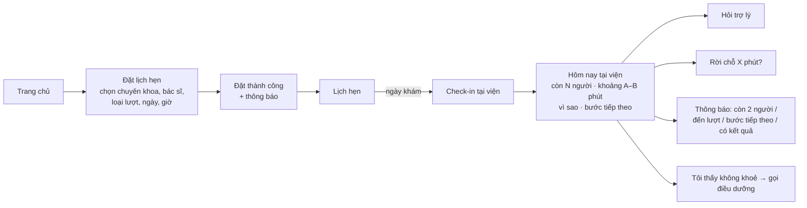

# Prototype: "Hôm nay tại viện" + Trợ lý chờ khám (mô phỏng giao diện MyVinmec)

**Chạy:** mở [index.html](index.html) bằng Chrome hoặc Edge (bấm đúp vào file). Không cần cài đặt. Bên phải điện thoại là bảng **Điều khiển demo** (chỉ người thử nghiệm thấy).

> Giao diện **mô phỏng phong cách** MyVinmec để người thử thấy quen thuộc; đây **không phải app chính thức**. Không dùng logo, ảnh hay dữ liệu thật của Vinmec. Bác sĩ, cơ sở và phòng khám đều là giả lập.

## Luồng người dùng

- **Làm thật:** Đặt lịch (đủ trường, kiểm tra lỗi, **tự lưu bản nháp**), Lịch hẹn, Check-in, Hôm nay tại viện, Thông báo, Trợ lý.
- **Chỉ là hình:** các ô khác trên trang chủ (Sổ tiêm, Đơn thuốc…). Bấm vào sẽ báo "ngoài phạm vi".

## Từ insight đến tính năng

| Insight / điểm đau | Tính năng | Cách làm |
|---|---|---|
| P2: "điền đầy đủ gửi đi thì lại mất thông tin vừa khai" | Form đặt lịch **tự lưu bản nháp**, mở lại thì khôi phục | Quy tắc |
| PP2: không biết còn bao lâu (4/5) | "Còn N người · khoảng A–B phút" + **giải thích vì sao** | Mô hình thống kê ([wait-model.js](wait-model.js)) |
| PP3: không dám rời chỗ (4/5) | "Báo khi còn 2 người" + "Rời 10/20/30 phút có kịp không?" | Quy tắc trên cận dưới P10 |
| PP4: không biết bước tiếp theo (3/5) | Thanh hành trình; chặng sau khám hiện khi bác sĩ chỉ định; thông báo "bước tiếp theo" | Quy tắc |
| Chờ kết quả lâu, lo âu | "Kết quả dự kiến có sau A–B phút, có thể đi ăn uống, app sẽ báo" | Mô hình (thời gian trả kết quả) |
| Câu hỏi tự do khi chờ | Trợ lý chat, mỗi câu trả lời có dòng **Nguồn** | **AI (Claude)** hoặc luật cố định |
| I5: không muốn AI làm việc y khoa | Từ chối câu hỏi bệnh, thuốc, kết quả | Bộ lọc + system prompt |
| An toàn | Nút "Tôi thấy không khoẻ" + phát hiện từ khoá nguy hiểm → thẻ đỏ, gọi điều dưỡng | **Quy tắc, chạy trước AI** |

**Trợ lý lấy thông tin từ đâu, và ước tính thế nào khi mỗi người khám lâu khác nhau?** Xem [nguon-du-lieu-uoc-tinh.md](nguon-du-lieu-uoc-tinh.md). Tóm tắt:
- Thời gian dựa trên **loại lượt** của từng người phía trước, cộng với **tốc độ thực tế của phòng hôm nay**, rồi mô phỏng ra một **khoảng**.
- Backtest trên dữ liệu giả lập: khoảng hiển thị chứa đúng thời gian thật 83% số lần; sai số trung bình 7,1 phút, so với 10,2 phút của cách "số người × 7 phút".

## Đồng hồ thật và thông báo khi còn 2 người

- Từ lúc **Check-in**, hàng chờ **tự tiến theo đồng hồ thật**. Ước tính tự đếm lùi mỗi phút và hiện giờ dự kiến ("dự kiến đến lượt khoảng 22:13–22:48"), không cần bấm gì.
- Khi còn 2 người, đến lượt, hoặc có kết quả: app hiện **thông báo hệ thống** của điện thoại hoặc máy tính, kêu 2 tiếng bíp và rung. Người bệnh đang ở app khác hay đi ra ngoài vẫn nhận được. Lần bấm Check-in đầu tiên, trình duyệt sẽ hỏi quyền thông báo, chọn **Cho phép**.
- Bảng demo có **Tốc độ đồng hồ**: thời gian thật (×1), ×10, ×60, hoặc tạm dừng, để buổi thử 15 phút đi hết được cả hành trình. Nút **+5 / +15 phút** vẫn dùng được.
- **Giới hạn của bản thử:** mọi thứ chạy trong trang web. Nếu khoá màn hình lâu, trình duyệt có thể tạm ngưng trang; mở lại thì hàng chờ tự đuổi kịp, nhưng thông báo có thể đến trễ. Thông báo hệ thống cần mở qua `http://localhost`, `https` hoặc Vercel, không chạy khi mở thẳng file. Trên iPhone, Safari chỉ cho thông báo khi trang đã được "Thêm vào màn hình chính". **Bản thật:** hàng chờ chạy ở máy chủ của viện và gửi push notification, không phụ thuộc trang có đang mở hay không.

## Cách demo (khoảng 4 phút)

1. Bảng điều khiển: bấm **⚡ Tạo nhanh lịch hôm nay**, hoặc tự đặt lịch qua nút **Đặt lịch** ở giữa thanh dưới (có link "Điền dữ liệu mẫu").
2. **Lịch hẹn → Check-in**. Nếu lịch là ngày mai, bấm "(demo) giả lập hôm nay là ngày khám".
3. Màn **Hôm nay tại viện**: còn 7 người, khoảng 40–80 phút, kèm lý do: *"tốc độ phòng hôm nay chậm hơn thường lệ ~20%"*.
4. Bấm "Rời 20 phút" → kịp; bấm **+15 phút** vài lần → thông báo "còn 2 người", rồi "đến lượt".
5. Tua tiếp → bác sĩ chỉ định xét nghiệm và siêu âm → bước mới hiện ra kèm thông báo → chờ kết quả.
6. **Hỏi trợ lý**: "Sao hôm nay lâu vậy?", "Đi ăn sáng 20 phút có kịp không?", "Kết quả xét nghiệm của tôi có sao không?" (bị từ chối), "Tôi thấy tức ngực" (thẻ đỏ).
7. Đổi kịch bản "Bác sĩ tạm vắng 15 phút" rồi check-in lại → ước tính tự cộng thêm và giải thích lý do.

## Chế độ trợ lý

- **Không có API key:** trả lời theo luật cố định. Demo chạy offline.
- **Có API key:** chọn nhà cung cấp trong bảng điều khiển: **OpenAI** (mặc định `gpt-4o`, sửa được tên model) hoặc **Anthropic** (`claude-opus-5-5`, effort `low`). Hai bên dùng **cùng** system prompt và cùng dữ liệu hàng chờ, và đều chạy **sau** các lớp an toàn (khẩn cấp, triệu chứng). Nếu gọi API lỗi (sai key, hết credit, mất mạng), app báo lỗi và tự chuyển sang luật cố định.
- Key chỉ nằm trong tab trình duyệt (sessionStorage), **không** nằm trong code hay bản deploy. Gọi API thẳng từ trình duyệt **chỉ dùng cho demo**; bản thật phải gọi qua máy chủ của viện.

## Bản deploy để người thử dùng trên điện thoại

Đề bài không bắt deploy (chỉ cần "mã nguồn hoặc file thiết kế"). Bản deploy chỉ phục vụ việc mời người thử.

- `python build-deploy.py <thư mục>` tạo bản công khai: **bỏ tên và slogan thương hiệu** (đổi thành "Chờ khám+"), thêm dòng "KHÔNG nhập thông tin thật". Lý do: một trang public trông giống app bệnh viện thật mà có form hỏi họ tên, SĐT thì dễ bị hiểu là trang giả mạo.
- Chạy local: `python -m http.server 5173` trong thư mục đó → `http://localhost:5173`, hoặc `http://<IP máy>:5173` từ điện thoại cùng Wi‑Fi.
- Lên mạng: `npx vercel --prod` trong thư mục đó, tác giả tự đăng nhập.
- Trên màn hình điện thoại, app tràn toàn màn hình và có nút nổi **⏩ +5'** để tua thời gian.

## File

| File | Nội dung |
|---|---|
| [index.html](index.html) | Toàn bộ prototype (HTML + JS, không thư viện ngoài) |
| [wait-model.js](wait-model.js) | Mô hình ước tính thời gian chờ (dùng chung cho app và backtest) |
| [backtest.js](backtest.js) · [backtest-ketqua.txt](backtest-ketqua.txt) | Kiểm chứng mô hình trên dữ liệu giả lập |
| [nguon-du-lieu-uoc-tinh.md](nguon-du-lieu-uoc-tinh.md) | Dữ liệu lấy từ đâu, mô hình, kết quả backtest, lộ trình |
| [prompts.md](prompts.md) | System prompt, bộ câu red-team, prompt đã dùng để xây |
| [log-thu-nghiem.md](log-thu-nghiem.md) | Kịch bản thử + log 2–3 người thử + kết quả red-team R1–R9 + những gì đã sửa |
| [build-deploy.py](build-deploy.py) | Tạo bản deploy công khai (bỏ thương hiệu) |
| [sw.js](sw.js) | Service worker tối thiểu để Android hiện được thông báo hệ thống (không cache, không gửi dữ liệu) |

## Đã kiểm tra tự động (trước khi cho người thật thử)

Chạy toàn bộ luồng trong Chrome headless: đặt lịch (kể cả báo lỗi khi để trống, khôi phục bản nháp), check-in, tua hết hành trình 6 chặng, 7 câu hỏi trợ lý, luồng khẩn cấp. **Không có lỗi JavaScript.** Các lỗi đã tìm ra và sửa:
- Từ khoá y khoa "bệnh" khớp nhầm "**bệnh** viện"; "uống" chặn nhầm "nước **uống** ở đâu".
- "Nhà vệ sinh ở đâu?" bị hiểu thành "tôi muốn rời chỗ".
- "Sao hôm nay lâu vậy?" không được nhận ra.
- Buổi tối không còn giờ trống trong ngày, nên nút "Điền dữ liệu mẫu" không chọn được giờ → chuyển sang ngày mai.
- Khoảng ước tính bản đầu quá tự tin (chỉ đúng 71%) → thêm độ bất định của tốc độ (đúng 83%).
- Red-team R1–R9 (chế độ không AI), chi tiết ở [log-thu-nghiem.md](log-thu-nghiem.md):
  - "Tôi hơi mệt" chưa được hướng tới nhân viên → thêm nhánh triệu chứng nhẹ chạy trước AI.
  - Xin chen lượt thì trả lời chung chung → thêm luật trả lời rõ.
  - Hỏi phòng không có dữ liệu → trả lời rõ "em chưa có thông tin này".
  - **Log lưu nguyên SĐT người dùng gõ vào** → thêm bước che SĐT và email trước khi ghi.
- **Thử thật với GPT‑4o:** AI trả lời "rời 30 phút → không nên", ngược với nút "Rời chỗ" (kịp), và xác nhận "đã xong xét nghiệm" dù dữ liệu không có. Đã sửa: code tính sẵn `roi_cho_toi_da_phut` để AI chỉ cần so sánh; thêm quy tắc "chỉ khẳng định những gì có trong dữ liệu". Vòng 2: cả 5 câu "rời chỗ" khớp với luật.
- **Tác giả tự thử:** đến lượt rồi mà chat vẫn hiện "còn 5 người". Trợ lý không tính sai (kiểm tra 182 phút liên tiếp đều đúng); lỗi là tin nhắn đã cũ. Đã thêm dòng trạng thái trực tiếp ở đầu chat và nhãn "ĐÃ CŨ" cho tin cũ.
- Bản sửa triệu chứng nhẹ lại gây lỗi mới: so khớp không dấu nên "đi **đâu**" bị hiểu là "**đau**" → chuyển sang so khớp có dấu, nguyên từ, và loại trừ "sốt ruột".
