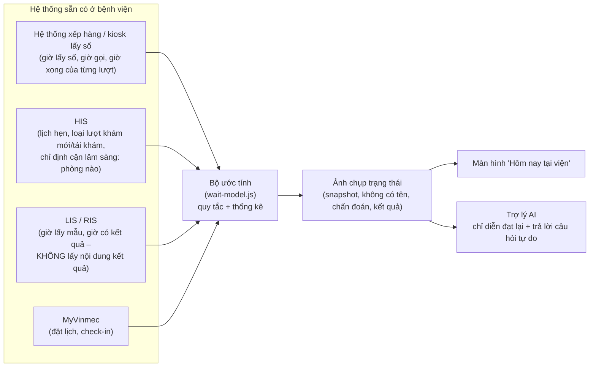

# Trợ lý lấy thông tin từ đâu? Ước tính thế nào khi mỗi người khám lâu khác nhau?

## 1. Trợ lý không "biết" gì tự thân

Trợ lý (AI) **không phải nguồn dữ liệu**. Nó chỉ diễn đạt lại dữ liệu do hệ thống của viện cung cấp:

- Mọi con số (còn bao nhiêu người, khoảng bao nhiêu phút, có kịp rời chỗ không) đều do **bộ ước tính** tính ra, không phải do AI đoán.
- Mỗi câu trả lời trong prototype đều ghi **"Nguồn: … · cập nhật lúc …"**, để người bệnh và người chấm thấy thông tin đến từ đâu.
- Nếu dữ liệu không có (ví dụ hỏi phòng X-quang ở đâu), trợ lý được dặn trả lời "em chưa có thông tin này" thay vì bịa.

## 2. Mỗi người khám lâu khác nhau: xử lý thế nào?

Đúng là không thể lấy "số người × 7 phút". Mô hình trong [wait-model.js](wait-model.js) xử lý theo 3 lớp:

| Lớp | Câu hỏi nó trả lời | Dữ liệu cần | Có cần thông tin y khoa không? |
|---|---|---|---|
| **1. Loại lượt** | Người phía trước là khám mới (~11 phút), tái khám (~6 phút) hay đọc kết quả (~4 phút)? | Loại lượt (đã có khi đặt lịch hoặc lấy số), lịch sử thời gian theo loại | **Không**. Đây là thông tin hành chính |
| **2. Tốc độ hôm nay** | Hôm nay phòng này nhanh hay chậm hơn thường lệ (bác sĩ, ca khó, thiếu điều dưỡng…)? | Giờ gọi số của 8 lượt gần nhất | Không |
| **3. Độ bất định** | Chắc chắn đến đâu? | Phân phối thời gian (không chỉ trung bình) | Không |

Cách tính: mô phỏng 800 lần "những người phía trước sẽ khám hết bao lâu", mỗi lần bốc ngẫu nhiên thời gian của từng người theo loại lượt của họ và một tốc độ hôm nay khả dĩ. Lấy **P10–P90** làm khoảng hiển thị.

**Vì sao cộng nhiều người lại đỡ sai?** Thời gian của từng người dao động rất mạnh, nhưng khi cộng 5–6 người, người nhanh và người chậm bù trừ cho nhau, nên tổng ổn định hơn từng phần. Cái khó đoán nhất lại là **tốc độ chung của cả buổi** (bác sĩ bị gọi đi cấp cứu, ca khó kéo dài). Vì vậy mô hình theo dõi tốc độ thực tế của phòng và cập nhật liên tục.

Khi biết có sự kiện (bác sĩ tạm vắng xử lý ca khẩn), nhân viên bấm 1 nút trên hệ thống. Ước tính tự cộng thêm thời gian và màn hình **giải thích lý do** cho người bệnh. Theo Maister, chờ được giải thích sẽ dễ chịu hơn chờ không rõ lý do.

## 3. Kiểm chứng (trên dữ liệu giả lập)

Chạy `node backtest.js` (kết quả lưu ở [backtest-ketqua.txt](backtest-ketqua.txt)). Thiết lập: 200 buổi khám giả lập, 37.000 lần dự đoán.

| Cách ước tính | Sai số trung bình | Thời gian thật nằm trong khoảng hiển thị |
|---|---|---|
| A. Số người × 7 phút | 10,2 phút | (không có khoảng) |
| B. Theo loại lượt | 8,4 phút | 63,6% |
| C. Loại lượt + tốc độ hôm nay (bản đầu) | 7,1 phút | 70,6% (**thấp hơn mục tiêu 80%**) |
| **C. Bản sửa: thêm độ bất định của tốc độ** | **7,1 phút** | **83,2%** ✅ |

Quy tắc "chỉ nói *kịp* khi cận dưới ≥ thời gian rời đi + 10 phút": trong 16.998 lần nói "kịp", có 3 lần (0,02%) người bệnh lẽ ra đã lỡ lượt.

**Bài học từ lần sửa:** bản đầu tiên có sai số trung bình tốt nhưng khoảng hiển thị **quá tự tin** (chỉ đúng 71%). Nếu không backtest, mình đã cho người bệnh xem một khoảng thời gian "trông chính xác" nhưng sai gần 1/3 số lần.

> ⚠️ **Giới hạn quan trọng:** dữ liệu giả lập được sinh từ chính giả định của mô hình, nên kết quả này chỉ chứng minh **cơ chế chạy đúng như thiết kế**, chưa chứng minh **đúng ở Vinmec**. Các số trung vị (6, 11, 4 phút…) là giả định. Việc đầu tiên khi vào viện là lấy log hệ thống xếp hàng (giờ gọi số đã khử định danh, trong sandbox) và chạy lại đúng backtest này.

## 4. Lộ trình nếu có dữ liệu thật

| Giai đoạn | Làm gì | Khi nào bật cho người bệnh |
|---|---|---|
| 0. Chỉ hiển thị | "Còn N người" + bước tiếp theo, chưa có số phút | Ngay, rủi ro thấp (giống SingHealth) |
| 1. Mô hình này | Trung vị theo loại lượt + tốc độ hôm nay, học từ log 1–3 tháng | Khi khoảng P10–P90 phủ ≥ 80% trên dữ liệu thật |
| 2. Học máy | Thêm đặc trưng: bác sĩ, giờ trong ngày, thứ, mùa, tỉ lệ khám mới… (ví dụ hồi quy phân vị) | Khi giai đoạn 1 đã ổn và có đủ dữ liệu để vượt nó |
| Luôn luôn | Nếu dữ liệu quá 10 phút không cập nhật, **ẩn** số phút và chỉ hiện "còn N người" | – |
