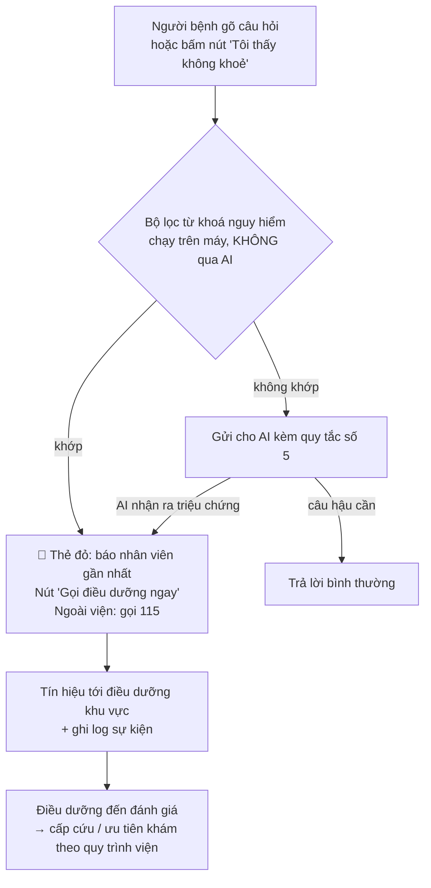

# Rủi ro an toàn, đạo đức và cách giảm thiểu

Nguyên tắc chung: **trợ lý chỉ làm hậu cần**. Mọi việc liên quan tới sức khoẻ đều thuộc về con người (bác sĩ, điều dưỡng). App **bổ sung** cho cách gọi số hiện tại (bảng, loa, quầy), không thay thế.

## 1. Bảng rủi ro

Mức độ: **C** = cao · **TB** = trung bình · **T** = thấp (khả năng × tác hại, đánh giá định tính)

| # | Rủi ro | Ví dụ cụ thể | Mức | Giảm thiểu (trong prototype ✅ / cho bản thật 🔜) |
|---|---|---|---|---|
| R1 | **Người bệnh có dấu hiệu nặng nhưng vẫn ngồi chờ** vì app nói "còn 40 phút" | Người bệnh tức ngực nhưng nghĩ "chờ thêm chút cũng được" | **C** | ✅ Bộ lọc từ khoá nguy hiểm chạy **trước** AI → thẻ đỏ và nút gọi điều dưỡng. ✅ AI có quy tắc số 5 làm lớp thứ hai. ✅ Nút "Tôi thấy không khoẻ" luôn có trên màn hình chờ, không cần gõ chữ. 🔜 Học từ HUG: ca nặng **không** được tham gia "chờ ở ngoài" |
| R2 | **AI tư vấn y khoa / diễn giải kết quả** | "Đường huyết 7.2 hơi cao thôi, không sao" | **C** | ✅ System prompt cấm, có câu từ chối mẫu. ✅ Ở chế độ không AI, bộ lọc từ khoá y khoa trả câu từ chối. ✅ Dữ liệu gửi cho AI **không chứa** kết quả hay chẩn đoán, nên AI không có gì để diễn giải. 🔜 Bộ red-team R3, R4, R6 phải đạt 100% trước mỗi lần cập nhật |
| R3 | **Ước tính sai → người bệnh lỡ lượt** | App nói "kịp" nhưng phòng gọi nhanh hơn dự kiến | **C** | ✅ Luôn hiện **khoảng**, chỉ nói "kịp" khi còn biên 10 phút. ✅ Ghi rõ "loa hoặc bảng gọi số là chuẩn". 🔜 Chính sách **giữ lượt khi lỡ** (ví dụ được xếp lại ngay sau 2 người kế tiếp), học từ HUG (nhắc lại mỗi 20 phút, tối đa 4 lần). 🔜 Đo sai số thật trước khi bật tính năng "rời chỗ". ⚠️ Bản thử gửi thông báo từ trang web nên có thể trễ nếu khoá màn hình lâu; 🔜 bản thật phải gửi push từ máy chủ, kèm SMS dự phòng |
| R4 | **AI bịa thông tin** (phòng, giờ, quy trình) | "Phòng X-quang ở tầng 4" trong khi không có dữ liệu | TB | ✅ Quy tắc 1: chỉ dùng dữ liệu cho sẵn; không có thì nói không biết. ✅ Mọi con số thời gian do bộ ước tính tính, AI chỉ diễn đạt lại ([nguon-du-lieu-uoc-tinh.md](../05-prototype/nguon-du-lieu-uoc-tinh.md)). ✅ Mỗi câu trả lời ghi nguồn và giờ cập nhật. ✅ Câu R8 trong bộ thử |
| R5 | **Lộ dữ liệu cá nhân** | 4/5 người lo lộ thông tin | C | ✅ Prototype không có dữ liệu thật; AI chỉ nhận số thứ tự, chặng, vị trí. 🔜 Thu thập tối thiểu, xử lý trên hạ tầng viện phê duyệt, có hợp đồng xử lý dữ liệu với nhà cung cấp AI, tuân thủ Nghị định 13/2023/NĐ-CP về bảo vệ dữ liệu cá nhân và các quy định hiện hành. 🔜 Không lưu nội dung chat lâu hơn mức cần thiết |
| R6 | **Lừa đảo mạo danh bệnh viện** | P4: "Sợ bị lừa đảo". Kẻ gian gửi SMS "đến lượt, bấm link thanh toán" | TB | 🔜 Thông báo **chỉ trong app chính thức** hoặc SMS brandname, **không bao giờ chứa link thanh toán**. 🔜 Truyền thông rõ: "Viện không bao giờ đòi chuyển khoản qua tin nhắn gọi lượt" |
| R7 | **Bất bình đẳng số** | Người già, người không có smartphone (5/5 chưa từng đặt lịch qua app) bị thiệt | TB | ✅ Dùng app **không** đổi thứ tự (học từ SingHealth). 🔜 Vẫn giữ bảng và loa; màn hình lớn ở sảnh hiển thị cùng thông tin; người nhà có thể theo dõi thay |
| R8 | **Lo âu tăng thêm** khi thấy thời gian chờ dài hoặc bị trễ | "Còn 90 phút" làm người bệnh bực hơn | T–TB | ✅ Giải thích lý do trễ (kịch bản "bác sĩ đang xử lý ca khẩn"). Theo Maister, chờ có lý do được giải thích sẽ dễ chịu hơn. 🔜 Đo mức lo lắng trong vòng thử |
| R9 | **Nhân viên phụ thuộc máy** hoặc bị tăng việc | Điều dưỡng phải nhập trạng thái thủ công | TB | 🔜 Lấy dữ liệu tự động từ hệ thống xếp hàng/HIS; nếu phải nhập tay thì không triển khai (HUG cũng nêu khối lượng việc của điều dưỡng là hạn chế) |
| R10 | **Tự chẩn đoán trong lúc chờ** | P5 tra cứu bệnh trên mạng khi chờ | T | ✅ Trợ lý từ chối và chuyển về bác sĩ. 🔜 Có thể gợi ý "ghi lại câu hỏi để hỏi bác sĩ" (một ghi chú, không phải AI trả lời) |

## 2. Đường chuyển tuyến khẩn cấp

**Nguyên tắc:**
1. **Không phụ thuộc AI.** Lớp đầu tiên là danh sách từ khoá cố định (đau ngực, tức ngực, khó thở, ngất, xỉu, co giật, chảy máu, yếu nửa người, méo miệng, nói khó, lơ mơ, tím tái, sốt cao, đau dữ dội, ý nghĩ tự tử…). Danh sách nhận cả câu gõ không dấu.
2. **Thà báo nhầm còn hơn bỏ sót.** Báo nhầm thì chỉ tốn một lần điều dưỡng hỏi thăm; bỏ sót có thể nguy hiểm tới tính mạng.
3. **App không tự xử lý ca khẩn cấp.** App chỉ đưa người bệnh tới con người nhanh nhất có thể.
4. 🔜 Danh sách từ khoá và quy trình "gọi điều dưỡng" phải được **khoa Cấp cứu và điều dưỡng trưởng Vinmec duyệt** trước khi thử với người thật.

## 3. Đạo đức trong quá trình làm bài

- Xin đồng ý trước khi khảo sát; 5/5 đồng ý.
- Chỉ hỏi về trải nghiệm dịch vụ; các câu dễ chạm tới bệnh đều ghi "không cần ghi kết quả là gì".
- Email/Zalo người tham gia để lại đã bị **xoá** trước khi đưa vào repo. File xlsx gốc **không** được commit (xem `.gitignore`).
- Không đưa lời khuyên y khoa trong khảo sát lẫn prototype.
- Ghi rõ phần nào do AI tạo (README gốc).
